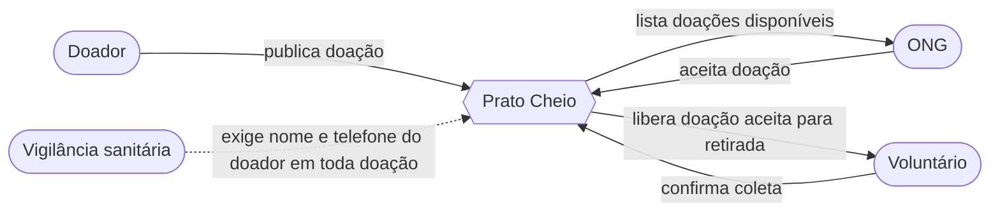

# Diagrama de Contexto

**Pergunta:** quem interage com o Prato Cheio e o que cada ator troca com o sistema?

**Decisão que sustenta:** Decisão de análise (`docs/analise.md`), a história zero cobre só publicar → listar → aceitar, autenticação, filtro de proximidade e notificação ficam fora, então o diagrama mostra os atores da história zero e a Vigilância como stakeholder regulatório.

**Situação:** retrato da `main` no commit `857406b`, Voluntário e a seta "confirma coleta" aparecem porque fazem parte do caso descrito na Análise, mas **a implementação atual não tem rota nem coluna para esse evento** (ver divergência 2 em `docs/diagramas/dados.md`).

