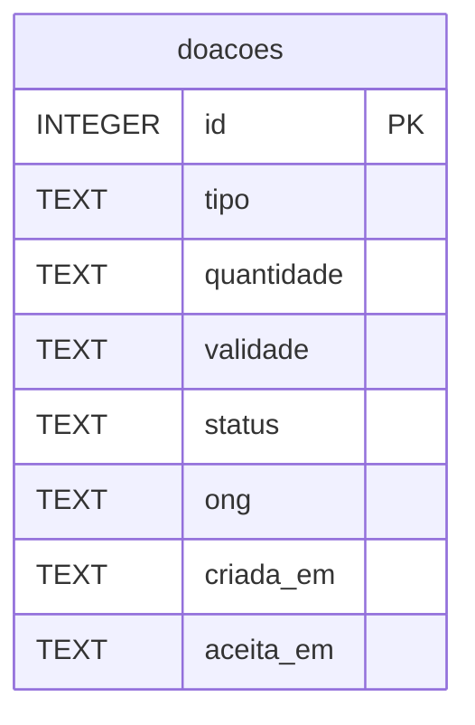

# Modelo de Dados Principal

**Pergunta:** quais dados o Prato Cheio guarda sobre uma doação, e isso bate com o schema real?

**Decisão que sustenta:** ADR 0001 (`docs/adr/0001-migracao-postgresql.md`), o schema abaixo é o que será portado para PostgreSQL na Unidade 3, qualquer coluna que falte aqui falta também na migração.

**Situação:** retrato da `main` no commit `857406b`, idêntico a `src/db.js`, função `migrar()`.

## Divergências entre este diagrama e `src/db.js`

1. **Nome e telefone do doador** — a Regra 1 da Análise e a seta da Vigilância no diagrama de contexto exigem nome e telefone do doador em toda doação, mas nenhuma coluna existe para isso, nem aqui, nem em `src/db.js`.
2. **Coleta por voluntário** — o diagrama de contexto mostra "Voluntário confirma coleta", mas não há `coletada_em` nem campo equivalente aqui ou em `src/db.js`. A interação existe no fluxo, não no dado.
3. **`ong` sem tabela própria** — `ong` é `TEXT` solto, sem chave estrangeira. `repositorio.aceitar(id, ong)` grava qualquer string recebida, não há cadastro de ONGs nem validação contra um conjunto conhecido. Isso bate com `src/db.js` hoje (não é um bug de sincronização), mas é uma limitação estrutural do modelo que vale registrar.